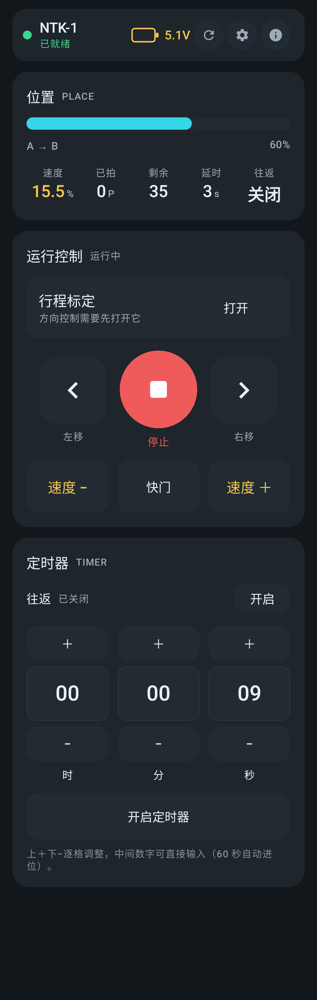
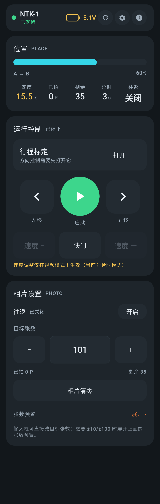
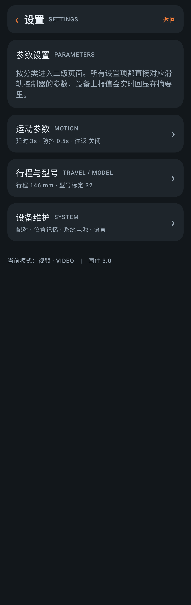

# NTK-1 摄影滑轨 · Android 遥控端

诺泰科 NTK-1 电控摄影滑轨的**非官方** Android 原生遥控 App。
原厂只提供微信小程序，本项目把它重制为原生应用：重做界面、补齐全部 78 条设备指令、修复官方小程序的若干链路缺陷。

蓝牙协议与原版**兼容**，设备固件无需任何改动。

> **免责声明**：本项目是非官方第三方客户端，与诺泰科（Nuotaike）无任何关联，
> 未获得其授权或背书。所有商标、产品名称归各自所有者。
> 蓝牙协议规格由公开的通信行为分析整理而成，仅用于互操作性目的。
> 使用本软件造成的设备损坏或数据丢失，作者不承担责任。

---

## 功能

**连接与诊断**
- 自动扫描 `NTK-1` / `JDY-19`，连接后自动拉取全量状态
- 链路日志逐条显示收发帧，另有「原始指令」输入框可直接下发任意 6 字节帧
- 断线指数退避自动重连；「复位链路」一键清干净卡死状态

**遥控主页**
- 位置进度条 + 速度 / 已拍 / 剩余 / 延时 / 往返 实时回显
- 启动与停止合并为同一个圆形按钮
- 快门两侧为速度 −／＋（单击一步，长按连续）
- 行程标定开关（进入后方向键变为"按住移动"）
- 底部工作模式条：视频 / 延时 / 定格 / 外触

**按模式切换的底部面板**
- **视频模式** → 定时器：时/分/秒 闹钟式输入，上＋下−、可直接输入、60 秒自动进位
- **延时 / 定格 / 外触模式** → 相片设置：目标张数输入框（±1/±10/±100 组合下发）、
  张数预置下拉、相片清零、往返开关
- 两个面板都带往返开关

**设置**
- 运动参数、行程与型号（12 档行程）、设备维护（配对、位置记忆、系统电源、键锁、语言）

## 界面

| 视频模式 | 延时模式 | 设置 |
|---|---|---|
|  |  |  |

更多截图见 [`docs/screenshots/`](docs/screenshots/)。

---

## 安装

从 [Releases](../../releases) 下载 APK 安装即可。需要 **Android 8.0+** 且支持蓝牙 4.0。

首次使用：滑轨上电 → App 右上角 **ⓘ 设备** → 授予蓝牙权限 → 开始扫描 → 点选 `NTK-1` 连接。

详细步骤见 [docs/安装说明.md](docs/安装说明.md)。

## 构建

```bash
# 需要 JDK 17 与 Android SDK 35
export JAVA_HOME=/path/to/jdk-17
export ANDROID_HOME=/path/to/android-sdk

./gradlew :app:assembleDebug        # 调试包
./gradlew :app:testDebugUnitTest    # 单元测试（协议层回归，无需真机）
./gradlew :app:assembleRelease      # 发布包
```

仓库不含签名密钥：`app/build.gradle.kts` 检测到根目录没有 `keystore.properties` 时，
会自动回退到调试签名，因此 clone 下来即可直接构建。

若要出正式包，在根目录放 `keystore.properties`：

```properties
storeFile=your-release.jks
storePassword=...
keyAlias=...
keyPassword=...
```

---

## 工程结构

```
app/src/main/java/com/nuotaike/ntk1/
├── protocol/            纯 Kotlin，可脱机单测
│   ├── SliderCommand    78 条下行指令（含 12 档行程枚举）
│   ├── FrameCodec       帧编解码 + 接收缓冲切帧
│   ├── Telemetry        上行解析 + 量程校验
│   └── SliderState      设备状态唯一真相
├── ble/
│   ├── BleModels        连接状态机 / 扫描结果 / 链路日志
│   └── BleClient        扫描、GATT 会话、写入队列、接收缓冲、自动重连
├── domain/
│   ├── SliderRepository 遥测 → 界面状态，断开即清空
│   ├── PhotoTargetPlanner  张数差值 → ±1/±10/±100 指令序列
│   └── TimerPlanner        时分秒差值 → ±秒/分/时 指令序列
└── ui/
    ├── theme/           色板、字号、深/浅色主题
    ├── components/      卡片、步进器、长按连发、电量表
    ├── RemoteScreen     遥控主页（含定时器 / 相片设置两种底部面板）
    ├── ParamsScreen     设置（二级菜单）
    ├── DeviceScreen     扫描连接 / 诊断日志 / 原始指令
    ├── SliderViewModel  单一 ViewModel（手工依赖容器）
    └── AppRoot          界面导航 + 权限编排
```

**分层原则**：`protocol` 不认识 Android，`ble` 不认识业务语义，UI 只消费 `StateFlow`。
因此协议层可以在没有蓝牙硬件的情况下完整单测。

## 协议

完整的报文规格见 [docs/BLE协议说明.md](docs/BLE协议说明.md)：

- 下行 `A5 5A 04 CMD_H CMD_L AA`，共 **78 条**指令
- 上行 `A5 5A LEN CMD DATA_H DATA_L [X] AA`，**30 类**上报
- 服务/特征 UUID 未硬编码，运行时取第一个可写 / 可通知特征

几个实测确认的关键点：

| 发现 | 说明 |
|---|---|
| `B2B6` / `B8BC` 是**调速** | 官方标为「上升/下降」，在这台滑轨上实际调节速度（每步约 0.5%），且**仅在视频模式生效** |
| 目标张数有**设备下限 20** | 低于 20 时指令照发，固件拒绝执行 |
| 定时器停止时**不回传设定值** | 设备只在定时器开启后才上报真实时长，故 App 采用本地即时回显 |
| 「行程标定」是方向控制前置条件 | 不打开它，设备不响应任何方向指令 |
| 扫描与连接**互斥** | 已连接时扫描会干扰 GATT 链路，导致掉线且状态机卡死 |

## 测试

```bash
./gradlew :app:testDebugUnitTest
```

67 个用例，覆盖帧编解码、上报解析、状态机、张数/定时器指令规划，
以及基于 Robolectric 的界面冒烟测试与截图回归。

## 已知限制

1. **参数无法设定任意数值**——协议里不存在该指令，只能 `+/−` 步进或用预置档。
   这是固件限制，不是本 App 的取舍。
2. **速度键只在视频模式生效**——固件行为，界面已按模式禁用并提示。
3. **目标张数下限 20**——固件行为。
4. **不支持后台常驻连接**——App 在前台时保持连接；切后台较久可能断链，返回后自动重连。
5. **上行帧第 7 字节语义未确认**——官方从未读取它，本实现同样忽略，仅校验帧尾 `AA`。
6. **定时功能没闹明白干嘛的，而且回显极其麻烦，期待有人折腾一下

## License

[MIT](LICENSE)
